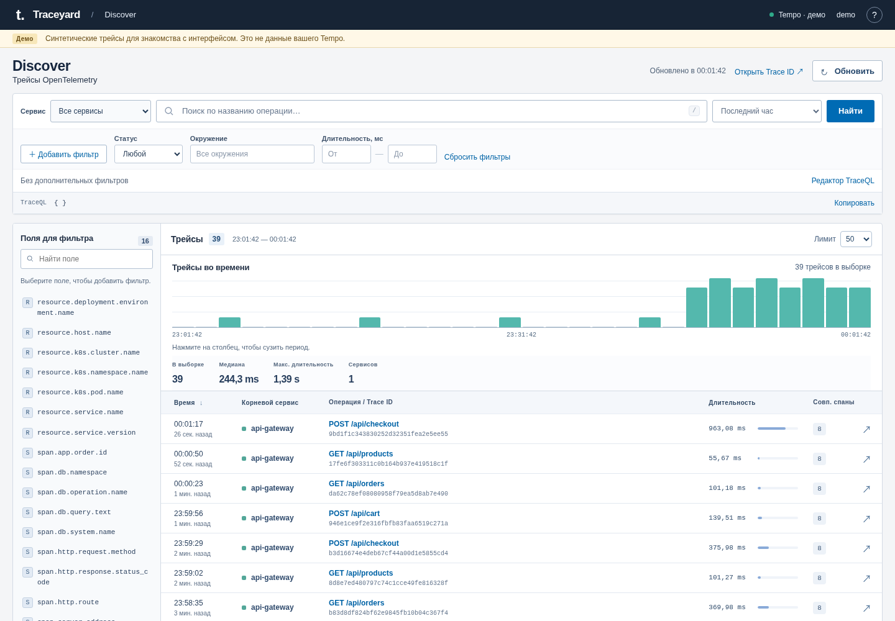

# Traceyard

**A Discover-style interface for OpenTelemetry traces in Grafana Tempo.**

Find a request, narrow the time window, and follow its spans without building a dashboard. Traceyard puts searchable fields, visual filters, TraceQL, a result histogram, and a span waterfall in one workspace.

The complete application is open source under the [MIT license](LICENSE). LDAP authentication, shared sessions, role enforcement, user blocking, audit logs, and Kubernetes deployment are included in the same codebase. There are no paid feature gates or license keys.



## What you can do

- Search by service, operation, status, environment, duration, or arbitrary span/resource attributes. Use the generated TraceQL or edit it directly.
- Explore a time histogram and a sortable trace table. Click a histogram bucket to search a smaller interval.
- Open a trace by ID, inspect its span tree, attributes, events, and links, or download its JSON.
- Sign in with Active Directory credentials. Viewers can explore and download traces; the configured administrator can inspect users and audit records and block or unblock viewers.
- Run a local demo or deploy the same application with LDAP and PostgreSQL. Production-specific values belong in a separate private configuration repository.

Trace data stays in Tempo. The Python server proxies requests; the browser never receives the Tempo URL or credentials. OpenTelemetry Collector forwards telemetry but does not provide a search API: `TEMPO_URL` must point to Tempo's HTTP API or gateway, not OTLP ports 4317/4318.

The histogram, median, maximum duration, and service count describe **the loaded result sample**, not every trace in the selected period. A reached result limit is shown in the UI. Matched spans are search matches, not a trace's total span count. Visual conditions are joined with `&&` and must match the same span.

## Try the demo

Requires Docker, or Python 3.11+ for a source checkout. These commands run from the repository root.

```bash
git clone https://github.com/fegasaren/traceyard.git
cd traceyard
docker build -t traceyard:0.3.1 .
docker run --rm --name traceyard-demo \
  --read-only --tmpfs /tmp:rw,noexec,nosuid,nodev,size=16m \
  --cap-drop=ALL --security-opt=no-new-privileges:true \
  -e TRACE_MODE=demo -e AUTH_MODE=disabled \
  -p 127.0.0.1:8080:8080 traceyard:0.3.1
```

Open [localhost:8080](http://127.0.0.1:8080). The demo uses synthetic data and does not need Tempo, LDAP, or PostgreSQL. Authentication is explicitly disabled; there is no admin account in this mode.

For Python:

```bash
python3 -m venv .venv
. .venv/bin/activate
pip install -r requirements.txt
TRACE_MODE=demo AUTH_MODE=disabled HOST=127.0.0.1 python server.py
```

Runtime dependencies are pinned in `requirements.txt`: `ldap3`, `psycopg`, and `prometheus-client`. The frontend uses plain HTML, CSS, and JavaScript with no build step.

## Connect Tempo and your directory

`TRACE_MODE=tempo` uses real data and defaults to `AUTH_MODE=ldap`. LDAP mode requires all four authentication settings below; providing only `TEMPO_URL` is insufficient.

| Setting | Purpose |
| --- | --- |
| `TEMPO_URL` | Reachable HTTP API URL for Tempo, for example `http://tempo.observability.svc.cluster.local:3200` |
| `AUTH_MODE` | `ldap` for directory authentication; `disabled` for an explicitly unauthenticated installation |
| `PUBLIC_ORIGIN` | Exact browser origin, such as `http://traceyard.example.org`, without a path, query, or trailing slash |
| `ADMIN_UPN` | The single administrator's canonical UPN, for example `admin@example.org` |
| `LDAP_REALMS` | JSON array of directory realms, including domain, URL, base DN, and accepted aliases |
| `DATABASE_URL` | PostgreSQL connection DSN, supplied through a secret rather than committed or passed as a shell argument |
| `SESSION_TTL_SECONDS` | Session lifetime; default `28800` (8 hours) |
| `AUDIT_RETENTION_DAYS` | Audit retention; default `30` days |
| `HTTP_MAX_CONCURRENCY` | Concurrent HTTP request limit; default `16` |
| `TRUSTED_PROXY_CIDRS` | Comma-separated CIDRs of actual reverse proxy peers; empty by default |

Example realm configuration; replace it with your directory's settings:

```json
[
  {
    "name": "main",
    "url": "ldap://ldap.example.org:3268",
    "domain": "example.org",
    "base_dn": "DC=example,DC=org",
    "aliases": ["main"]
  },
  {
    "name": "regions",
    "url": "ldap://regions.example.org:3268",
    "domain": "regions.example.org",
    "base_dn": "DC=regions,DC=example,DC=org",
    "aliases": []
  }
]
```

`main\admin` resolves to `admin@example.org`. Any successfully authenticated directory user receives the viewer role unless its canonical UPN equals `ADMIN_UPN`. Roles cannot be edited through the browser. Authentication performs a directory bind as the user; a separate service-account password is not required. Elasticsearch Native Realm users are not supported.

For Tempo gateways, optional settings are `TEMPO_TENANT_ID`, `TEMPO_BEARER_TOKEN`, or `TEMPO_USERNAME` / `TEMPO_PASSWORD`. `TEMPO_CA_FILE` supplies a custom CA bundle; TLS certificate verification remains enabled. `TEMPO_TIMEOUT_SECONDS` defaults to `30`. Inside a container, `127.0.0.1` refers to that container, not the host running Tempo.

## Sessions, permissions, and audit

The UI checks the current session before requesting trace data. Password fields are cleared after each login attempt. An expired or revoked session returns the UI to login and clears loaded trace and administration data. Server-side authorization protects the API independently of hidden buttons.

Sessions, users, blocks, and audit records are stored in PostgreSQL and shared by all application replicas. Cookies contain opaque session identifiers with `HttpOnly` and `SameSite=Strict`. Authenticated mutations require a CSRF token and matching origin. The configured administrator cannot block itself; blocking a viewer revokes its sessions across replicas.

The supplied deployment supports HTTP and does not provision TLS or certificates. HTTP UI traffic and plain `ldap://` binds are unencrypted; use them only on a network where that is acceptable. Set the public origin to the actual browser-facing scheme and address, and configure an HTTPS reverse proxy and directory TLS where required.

The administrator opens **Админка** in the top bar to search users, block/unblock viewers, and filter the audit log by actor or event. The log loads newest records first and can load earlier pages. The trace drawer's **Скачать JSON** button is available to viewers as well as administrators.

Server audit covers login outcomes, logout, searches, tag lookups, trace views/downloads, administration reads, and block changes. Request completion records provide HTTP outcome and duration; an action marked requested does not itself prove success. Search records contain a query hash and search bounds, not raw TraceQL. Browser events cover span selection, span tabs, and copying queries, trace IDs, or links; these events are best effort and identified as browser-sourced. Passwords, session tokens, and copied query contents are not audit payloads.

With `TRUSTED_PROXY_CIDRS` empty, audit and login throttling use the immediate TCP peer. Behind an ingress this is usually the proxy address, so users may share a rate-limit bucket. Only trust explicit proxy CIDRs and ensure the proxy correctly replaces or appends `X-Forwarded-For`. Traceyard selects the first untrusted address from the right; `/0` is rejected. This must be configured and verified before interpreting the audit IP as the end user's address.

## Kubernetes

The Helm chart deploys **two application replicas and one PostgreSQL 17 instance** with a 1 GiB PVC. Redis and a separate authentication service are not required. The chart uses LDAP authentication and real Tempo data. PostgreSQL is a single point of failure: two UI replicas do not provide database high availability. An external PostgreSQL deployment is supported with `postgres.enabled=false`.

1. Build and push the application image to your chosen registry; mirror `postgres:17-alpine` if required. The PostgreSQL image uses UID/GID 70; a mirror must retain that image variant.
2. Copy `deploy/values.example.yml` to a **private** values file or private deployment repository. Configure the image, public origin, administrator, realms, Tempo endpoint, ingress selectors, and actual directory/DC CIDRs. Example domains and `192.0.2.*` addresses are documentation placeholders.
3. Provision the named `existingSecret` through your secret-management process. Bundled PostgreSQL requires three keys: `database-url` for the application's DSN, `app-password` with that same application password, and `postgres-password` with a separate bootstrap administrator password. The DSN must match `postgres.username` and `postgres.database`; URL-encode password characters. The application receives only `database-url`. No real credentials belong in values, Git, shell arguments, or screenshots.
4. Review the rendered deployment before installing or syncing it.

For `fullnameOverride: traceyard`, bundled PostgreSQL is reached at `traceyard-postgres.<namespace>.svc.cluster.local:5432`. First initialization on a fresh PVC creates a separate application role without superuser privileges; existing database volumes are not automatically migrated by initialization scripts. Changing a Kubernetes Secret does not rotate a password already stored in PostgreSQL. With an external database, only `database-url` is required; configure a suitable application role and `networkPolicy.externalPostgresCidrs`. Optional Tempo credential Secrets can be referenced by name through `extraEnvFromSecrets`.

For direct Helm operation:

```bash
helm lint chart/ -f /path/to/private/traceyard-values.yaml
helm template traceyard chart/ \
  --namespace traceyard -f /path/to/private/traceyard-values.yaml
helm upgrade --install traceyard chart/ \
  --namespace traceyard --create-namespace \
  -f /path/to/private/traceyard-values.yaml
```

### Argo CD registration with Ansible

`deploy/argocd.yml` registers an Application in an **existing** Argo CD installation. Ansible runs locally with an existing kubeconfig; it does not install a cluster or run Helm itself. Argo CD renders the chart. Automatic sync is off by default; the operator reviews the diff and starts Sync. Opting into `traceyard_automated_sync=true` enables self-heal without prune.

To keep the application public and deployment settings private, use Argo CD 2.6+ multi-source values:

```yaml
traceyard_kube_context: your-approved-context
traceyard_repo_url: https://github.com/fegasaren/traceyard.git
traceyard_revision: your-reviewed-tag-or-commit
traceyard_chart_path: chart
traceyard_namespace: traceyard
traceyard_argocd_project: observability
traceyard_values_repo_url: ssh://git.example.org/platform/private-deployments.git
traceyard_values_revision: your-reviewed-private-commit
traceyard_values_files: ['$values/traceyard/values.yaml']
traceyard_automated_sync: false
```

The Argo CD project must allow both repositories and the destination namespace. Argo CD needs credentials for the private repository. Omit `traceyard_values_repo_url` and `traceyard_values_revision` for the original single-source mode; then `traceyard_values_files` paths are relative to `traceyard_chart_path` and must exist in that Git revision. Ignored files on your workstation are not available to Argo CD.

```bash
ansible-galaxy collection install -r deploy/requirements.yml
ansible-playbook -i localhost, deploy/argocd.yml \
  -e @/path/to/private/traceyard-argocd-vars.yml
```

The runner also needs the Python `kubernetes` package. Optional variables include `traceyard_argocd_namespace`, `traceyard_application_name`, `traceyard_release_name`, `traceyard_kubeconfig`, and `traceyard_destination_server`. This workflow does not change worker firewalls, systemd units, or the lab cluster inventory.

### Network policy, resources, and health

SIGTERM/SIGINT stop accepting requests and wait for active handlers and final audit writes.
The chart allows 60 seconds (`terminationGracePeriodSeconds`); increase it if you raise
upstream timeouts. Kubernetes can still force termination after that period.

NetworkPolicy is enabled by default. It permits UI ingress from the configured ingress controller and, when scraping is enabled, Prometheus. Egress permits configured DNS on port 53, Tempo, directory CIDRs on port 3268, and PostgreSQL on port 5432. The bundled database accepts ingress only from this release's UI pods and has no permitted outbound connections. Empty directory CIDRs and `/0` are rejected. DNS names cannot substitute for IP/CIDR entries.

Review these rules against the actual CNI, DNS, and ingress setup. NodeLocal DNS and host-network ingress may require different rules. `networkPolicy.ldapPorts` defaults to `[3268]`; when changing realm URLs, allow their actual ports, such as `389`, `636`, or `3269`. If enabling NodePort, set `service.nodePort` and explicit `networkPolicy.nodePortSourceCidrs`; `externalTrafficPolicy: Local` serves only nodes with ready UI pods. Source-IP preservation and policy enforcement depend on the CNI.

| Component | CPU / memory requests | CPU / memory limits |
| --- | --- | --- |
| Each UI replica | `50m` / `64Mi` | `500m` / `256Mi` |
| Bundled PostgreSQL | `100m` / `128Mi` | `500m` / `256Mi` |

These are initial sizing values, not load-test results. `/healthz` checks the process; `/readyz` checks Tempo and, when authentication is enabled, PostgreSQL. `/metrics` exposes Prometheus metrics on port 8080. Enable `metrics.serviceMonitor.enabled` when Prometheus Operator CRDs are installed, or `metrics.scrapeAnnotations` for annotation-based discovery. Configure the real Prometheus labels separately in NetworkPolicy. Probes alone do not prove directory login or successful trace exploration.

## Portable image releases

For environments that import Docker images without pulling a registry:

```bash
OTEL_UI_IMAGE=traceyard:0.3.1 bash scripts/build-release.sh 0.3.1
```

The script builds an image and produces a `dist/` bundle with a Docker-loadable archive, checksums, image/platform metadata, deployment examples, and the chart. It supports `linux/amd64` and `linux/arm64`; set `PLATFORM` explicitly for a different target. Verify `SHA256SUMS` before `docker load`. Use unique image tags for upgrades and retain the previous image for rollback.

`deploy/otel-ui.service` and the accompanying environment examples support an optional Docker/systemd installation. Supply authentication and database settings separately, protect environment files, and set `OTEL_UI_IMAGE` to the image actually imported. The unit does not provision PostgreSQL or LDAP. It runs the container without Linux capabilities, with a read-only root filesystem and temporary `/tmp`; a Docker healthcheck alone does not trigger a restart.

## Development and current validation

A GitHub Actions workflow template is included at `.github/ci.yml.example`. To activate it, place it at `.github/workflows/ci.yml` using GitHub credentials permitted to manage workflows.

```bash
python3 -m unittest discover -s tests -v
node --check static/app.js
```

Backend tests and synthetic browser checks cover authentication boundaries, roles, logout/401 cleanup, administration, downloads, and rendering untrusted values as text. See [VALIDATION.md](VALIDATION.md) for the validation record and the 12 opt-in PostgreSQL tests. **Live LDAP integration and the final deployment on your directory, ingress, CNI, and Tempo have not been verified by those checks.** Run an actual login, search, trace view, download, block/unblock, and audit review before accepting an installation.

The current UI is in Russian. Bug reports, usability improvements, localization, and integration fixes are welcome. Include reproducible steps and sanitized versions/configuration; never attach credentials, private directory data, real trace payloads, or production overlays to a public issue.

Keep environment files, private values, secrets, runtime data, and release bundles out of the public repository. A private deployment uses the same complete application and a separate configuration overlay; there is no separate restricted edition.

## License

[MIT](LICENSE) © 2026 fegasaren.
